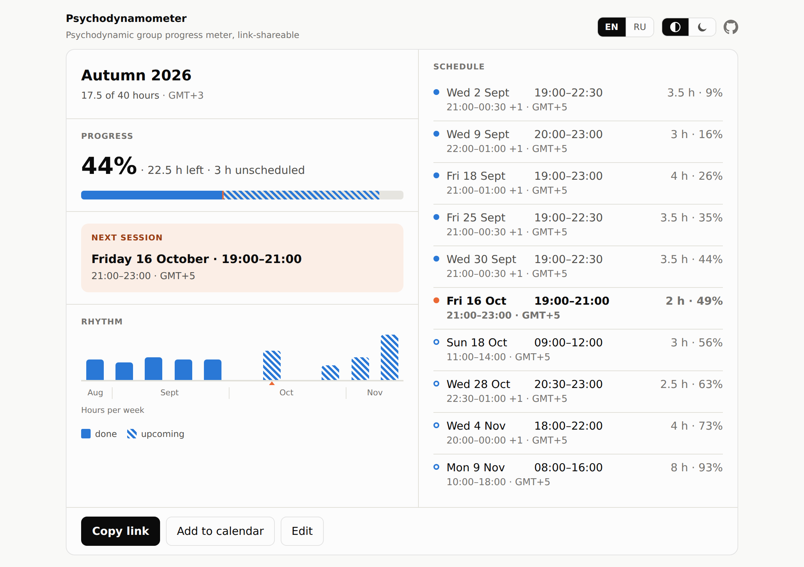

# Psychodynamometer

[](https://vintagentleman.github.io/psychodynamometer/)

> Static, shareable progress visualiser for time-bounded therapy and coaching groups.

Contracted hours vs hours done, the next session, weekly rhythm — computed in
the browser from data carried in the link itself. No server, no accounts, no
tracking.

[](https://vintagentleman.github.io/psychodynamometer/#d=AgBQCg1FdXJvcGUvTW9zY293NSKOlRg1KZYVkDUyjpWQNTmOlRg1Po6VGDVQjpOwNVJDi0A1XJnVkDVkhxSgNWk8DwBBdXR1bW4gMjAyNg)

## Usage

- Fill in the group name, target hours and sessions, press **Copy link**,
  share. Anyone opening the link sees the current progress, computed against
  their own clock.
- The link is the whole group — self-contained, and a snapshot: editing the
  schedule means sharing a new link, while the ones already sent keep showing
  the old plan.
- **Add to calendar** exports the schedule as an `.ics` file; links you have
  opened once keep working offline.

## Development

Vite + TypeScript, no framework. Node >= 26.

```bash
git clone https://github.com/vintagentleman/psychodynamometer.git
cd psychodynamometer
pnpm install
pnpm dev          # vite dev server
pnpm check        # the gate: typecheck + lint + format check + tests + build
pnpm test         # unit tests (vitest)
pnpm test:e2e     # end-to-end suite (playwright)
```

Commits follow [Conventional Commits](https://www.conventionalcommits.org),
subject line only; enable the commit hook with
`git config core.hooksPath .githooks`. See [`CLAUDE.md`](CLAUDE.md) for the
rest of the conventions.

## License

[MIT](LICENSE) © 2026 Konstantin Sipunin.
